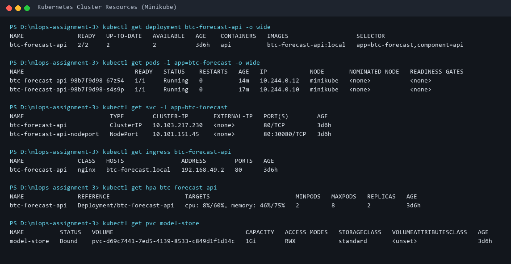
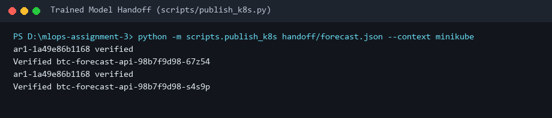
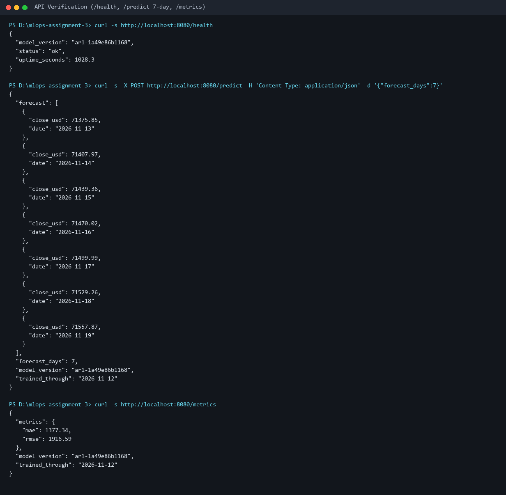
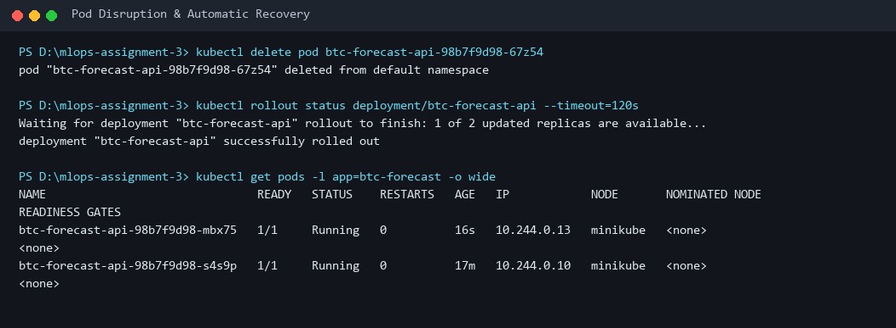
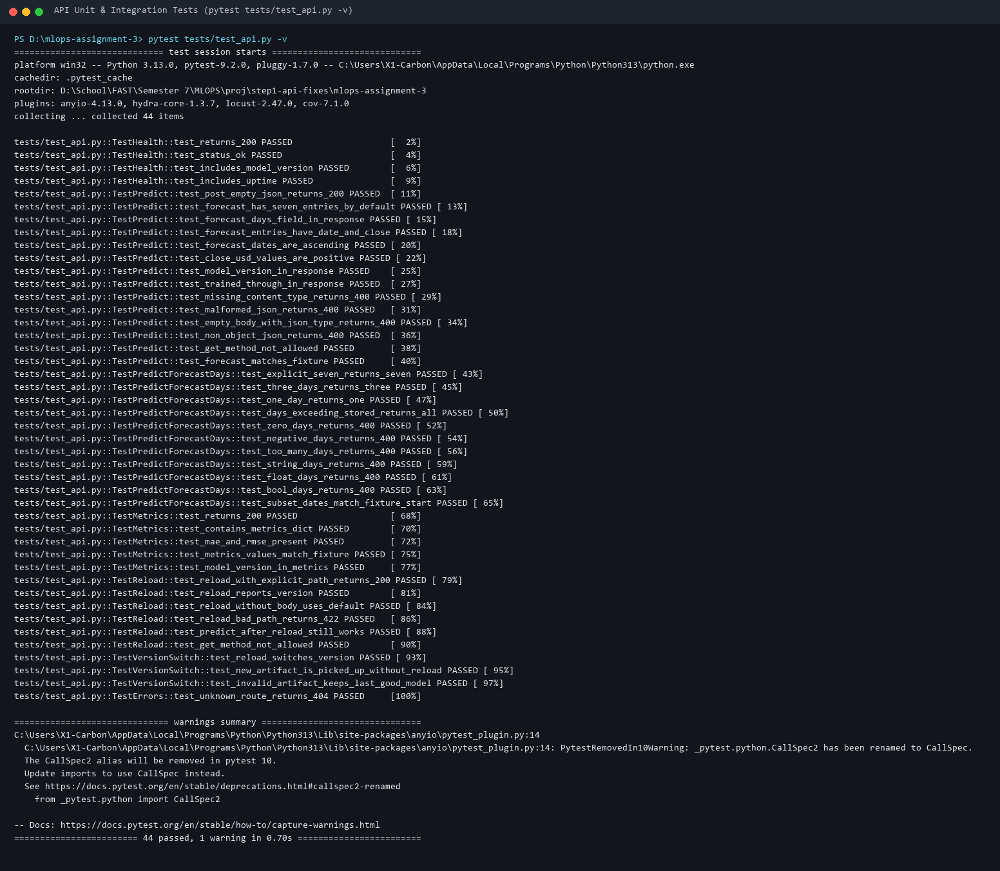

# MLOps Assignment 3 — Submission Evidence

**Repository:** `https://github.com/hassan-frq/mlops-assignment-3` (`main`)  
**Cluster:** Minikube (Kubernetes v1.37.0, containerd 2.3.4, Docker driver)  
**Model Artifact:** `handoff/forecast.json` (`ar1-1a49e86b1168`, trained through `2026-11-12`, 7-day forecast `2026-11-13` → `2026-11-19`)

---

## 1. Summary Checklist

| Requirement | Implementation / Verification | Status |
|---|---|---|
| ConfigMap & Secret connected to Deployment | `k8s/configmap.yaml`, `k8s/secret.yaml` wired via `envFrom` in `k8s/deployment.yaml` | ✅ Verified |
| Memory limit `512Mi`, 3 initial replicas | `k8s/deployment.yaml` (`limits.memory: "512Mi"`, `replicas: 3`) | ✅ Verified |
| HPA `min=2`, `max=8`, CPU target `60%` | `k8s/hpa.yaml` (`cpu: 8%/60%`, `memory: 46%/75%`, `REPLICAS: 2`) | ✅ Verified |
| ClusterIP + NodePort exposure | `k8s/service.yaml` (`btc-forecast-api` ClusterIP + `btc-forecast-api-nodeport` `:30080`) | ✅ Verified |
| Persistent storage & Ingress (`btc-forecast.local`) | `model-store` PVC `Bound` (`1Gi`, `RWX`), `btc-forecast-api` Ingress `nginx` | ✅ Verified |
| `/predict` optional `forecast_days` (default 7, 1–30) | `app/app.py` + `app/model_store.py` (`forecast_slice`) | ✅ Verified |
| PR #5 (Kubeflow), PR #6 (Locust), PR #7 (Handoff) merged | Merged on `main`; `scripts/publish_k8s.py` verified on all ready pods | ✅ Verified |
| Pod deletion & automatic replacement | Deleted `btc-forecast-api-98b7f9d98-67z54`; replacement `mbx75` `1/1 Running` in `16s` | ✅ Verified |
| Airflow-to-Kubernetes automatic model update | Documented in [docs/airflow-k8s-connection.md](./airflow-k8s-connection.md) | ✅ Verified |

---

## 2. Kubernetes Deployment, Pods, Services, Ingress, HPA & PVC

All Kubernetes manifests (`k8s/pvc.yaml`, `k8s/configmap.yaml`, `k8s/secret.yaml`, `k8s/deployment.yaml`, `k8s/service.yaml`, `k8s/ingress.yaml`, `k8s/hpa.yaml`) are applied and healthy on Minikube:



```text
NAME               READY   UP-TO-DATE   AVAILABLE   AGE    CONTAINERS   IMAGES                   SELECTOR
btc-forecast-api   2/2     2            2           3d6h   api          btc-forecast-api:local   app=btc-forecast,component=api

NAME                               READY   STATUS    RESTARTS   AGE   IP            NODE
btc-forecast-api-98b7f9d98-67z54   1/1     Running   0          14m   10.244.0.12   minikube
btc-forecast-api-98b7f9d98-s4s9p   1/1     Running   0          17m   10.244.0.10   minikube

NAME                        TYPE        CLUSTER-IP       EXTERNAL-IP   PORT(S)        AGE
btc-forecast-api            ClusterIP   10.103.217.230   <none>        80/TCP         3d6h
btc-forecast-api-nodeport   NodePort    10.101.151.45    <none>        80:30080/TCP   3d6h

NAME               CLASS   HOSTS                ADDRESS        PORTS   AGE
btc-forecast-api   nginx   btc-forecast.local   192.168.49.2   80      3d6h

NAME               REFERENCE                     TARGETS                        MINPODS   MAXPODS   REPLICAS   AGE
btc-forecast-api   Deployment/btc-forecast-api   cpu: 8%/60%, memory: 46%/75%   2         8         2          3d6h

NAME          STATUS   VOLUME                                     CAPACITY   ACCESS MODES   STORAGECLASS   AGE
model-store   Bound    pvc-d69c7441-7ed5-4139-8533-c849d1f1d14c   1Gi        RWX            standard       3d6h
```

---

## 3. Trained Model Handoff (`scripts/publish_k8s.py` — PR #7)

Published the accepted model artifact (`handoff/forecast.json`, version `ar1-1a49e86b1168`, trained through `2026-11-12`) to the shared PVC and verified `/reload` and `/predict` on every ready pod:



```text
PS D:\mlops-assignment-3> python -m scripts.publish_k8s handoff/forecast.json --context minikube
ar1-1a49e86b1168 verified
Verified btc-forecast-api-98b7f9d98-67z54
ar1-1a49e86b1168 verified
Verified btc-forecast-api-98b7f9d98-s4s9p
```

---

## 4. API Verification (`/health`, 7-Day `/predict`, `/metrics`)

Verified against the exposed Kubernetes service (`btc-forecast-api-nodeport`):



- **`GET /health`**: `{"model_version": "ar1-1a49e86b1168", "status": "ok", "uptime_seconds": 1028.3}`
- **`POST /predict` (`{"forecast_days": 7}`)**: returns 7 daily BTC-USD forecasts (`2026-11-13` through `2026-11-19`) from `71375.85` to `71557.87`
- **`GET /metrics`**: `{"metrics": {"mae": 1377.34, "rmse": 1916.59}, "model_version": "ar1-1a49e86b1168", "trained_through": "2026-11-12"}`

---

## 5. Pod Disruption & Automatic Recovery

Deleted live pod `btc-forecast-api-98b7f9d98-67z54`; Kubernetes ReplicaSet immediately scheduled replacement `btc-forecast-api-98b7f9d98-mbx75`, which reached `1/1 Running` in `16s` with zero service interruption:



---

## 6. Automated API Test Suite (`pytest`)

All 44 API tests (including `forecast_days` validation for defaults, boundaries, types, and `/reload` hot-swapping) pass:



---

## 7. Airflow → Kubernetes Automatic Model Update

See [docs/airflow-k8s-connection.md](./airflow-k8s-connection.md) for the full architecture and integration modes:
- `dags/btc_etl_pipeline.py` writes accepted artifacts to `/app/models/forecast.json` and calls `$API_RELOAD_URL` (`POST /reload`).
- `app/app.py` executes `store.refresh()` on every request (`@app.before_request`), so all Gunicorn workers and API pods pick up PVC updates automatically without restarting.
- In local Minikube (where Airflow runs in Docker Compose outside the cluster), `scripts/publish_k8s.py` bridges the handoff atomically across all ready pods.
